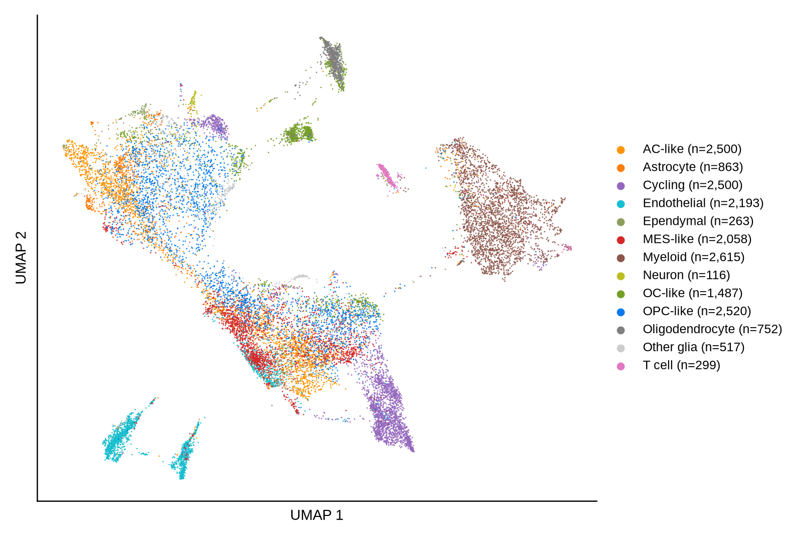

# dmg_spatial

Reproducible spatial organization of cell-state programs in diffuse midline glioma

Harmonized single-cell reference used to deconvolve 27 spatial sections: 18,683 cells
(3,269 Liu Smart-seq2, 15,414 Jessa 10x sc/snRNA) drawn from a 65,330-cell integrated
atlas, with five malignant-reference states and eight microenvironmental populations.
Integration used 3,000 highly variable genes, 50 principal components and Harmony over
patient; malignant states were transferred from Liu's published labels by 15-nearest-
neighbour vote (mean confidence 0.70).

Raw data are not held in this repository. Download them from the public accessions
listed in `tables/table01_dataset_overview.csv`, then run `scripts/` in numbered order.
